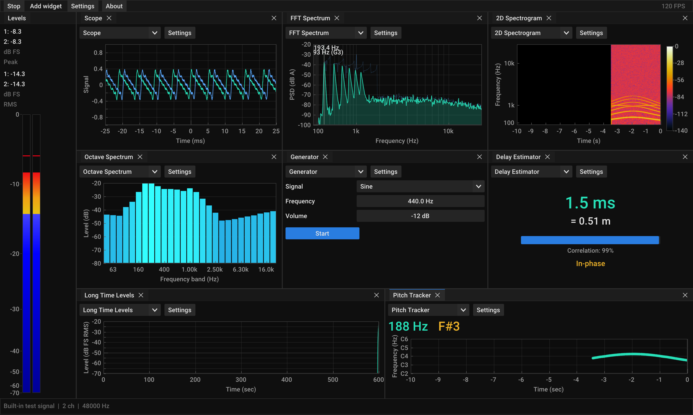

# friture-imgui

A C++ / [Dear ImGui](https://github.com/ocornut/imgui) rewrite of [Friture](https://github.com/tlecomte/friture),
the popular but visibly dated realtime audio visualizer



## widgets

| Widget name      | Function                                                                                                                                       |
| ---------------- | ---------------------------------------------------------------------------------------------------------------------------------------------- |
| Scope            | a visualizer of the wave form of audio. supports dual channel audio. with the sample span configurable in the settings button above the window |
| FFT Spectrum     | the audio spectrum. can be smoothed with configurable FFT window sizes                                                                         |
| 2D Spectrogram   | GPU based spectrogram (Linear / Log / Mel / ERB / Octave support)                                                                              |
| Octave Spectrum  | 1, 3, 6, 12 or 24 bands per octave with IEC style time response                                                                                |
| Long Time Levels | RMS level display with history up to 30 minutes                                                                                                |
| Delay Estimator  | GCC-PHAT interchannel delay (ms and metres) with correlation and polarity                                                                      |
| Pitch Tracker    | pitch estimate with note names                                                                                                                 |
| Generator        | audio signal generator (Sine, white noise / pink noise / log sweep / burst)                                                                    |

Plus IEC peak / RMS level meters, free docking, and an easily configurable layout.

## Build

needs CMake, Ninja, and a C++17 compiler. Dependencies (glfw, dear imgui, implot, miniaudio, pocketfft)  
are auto fetched by CMake

```sh
git clone https://github.com/SolidifiedPlayDoh/friture-imgui.git
cd friture-imgui
cmake -S . -B build -G Ninja -DCMAKE_BUILD_TYPE=Release
ninja -C build
./build/friture
```

Command-line flags: `--demo` (built-in test signal), `--list-devices`, `--no-save`,
`--screenshot out.png --frames N`, `--bench SECONDS`.

`FRITURE_CONFIG_DIR` overrides where settings and layout are stored.

## Credits and license

Derived from [Friture](https://github.com/tlecomte/friture) by Timothée Lecomte and contributors.  
Licensed under the GNU GPL v3 like the original.  


:3
